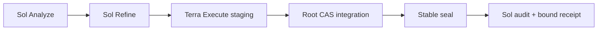

# Codex Three-Stage Workflow

An auditable Analyze → Refine → Execute workflow for Codex with bounded planning,
single-writer compare-and-swap integration, stable revision seals, and
revision-bound audit receipts.

[中文说明](docs/README.zh-CN.md) · [Installation](docs/installation.md) ·
[Architecture](docs/architecture.md) · [Security boundary](docs/security-boundary.md)

## Why this exists

Strong planning models can keep expanding details after a decision is ready.
Parallel agents can also collide on shared files or trigger repeated work when
content hashes, mtimes, or audit cutoffs change. This suite makes both failure
modes explicit and testable:

- Sol is assigned read-only Analyze, Refine, and Audit roles. Stage-exit
  contracts and repeated-issue fingerprints stop evidence-free planning loops.
- Terra performs approved Execute work. Writers stage privately; only the root
  integrator changes canonical files, using base-revision and hash checks.
- Stable seals distinguish metadata-only changes from semantic or late writes.
- Audit receipts bind the exact sealed revision, scope, evidence, verdict, and
  gates instead of certifying a mutable directory path.



## Included components

- `three-stage-complex-workflow`: stage, approval, scope, and loop-exit contract
- `staged-agent-run-protocol`: provenance, staging, CAS, seals, and receipts
- `dispatching-parallel-agents`: assignment and no-overlap rules
- `project-audit`: evidence-based pre-release and scientific audit gates
- portable JSON policy, custom agent examples, and `PreToolUse` guard
- dry-run installer, public-boundary auditor, unit tests, and contract validators

## Quick start

```bash
git clone https://github.com/lianglunping/codex-three-stage-workflow.git
cd codex-three-stage-workflow

python3 scripts/audit_public_release.py .
python3 scripts/validate_all.py

# Preview only; no writes.
python3 scripts/install.py --codex-home "${CODEX_HOME:-$HOME/.codex}"

# Apply after reviewing the preview.
python3 scripts/install.py --codex-home "${CODEX_HOME:-$HOME/.codex}" --apply
```

The installer never edits `config.toml` or `hooks.json`. Review and manually
merge the snippets under `examples/`. After enabling a hook, use `/hooks` in
Codex CLI to inspect and trust its exact definition.

## Compatibility

- macOS and Linux
- Python 3.9–3.13, standard library only
- Windows support is not claimed because the control plane uses `fcntl`

The default public policy registers only `gpt-5.6-sol` and
`gpt-5.6-terra`. Additional models are optional extensions and must be validated
against the actual Codex runtime before their roles are added.

## Security boundary

The hook evaluates declared Codex payload fields and emits redacted reason
codes. It fails open on internal errors and has an explicit disable sentinel.
It is defense in depth, not an OS security boundary. Keep Codex sandboxing,
approval policy, repository permissions, and human review enabled.

This repository contains only public, sanitized examples. The installer does
not copy sessions, credentials, user configuration, local audit receipts, or
project-specific instructions.

## License

Apache License 2.0. See [LICENSE](LICENSE).
