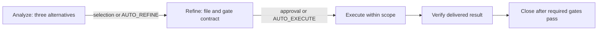

# Architecture

## Stages and authority

Activation requires an explicit invocation, a task-bound natural-language
bounded-autonomy request, or a verifiable matching ACTIVE run. Complexity and
workflow maintenance do not activate the state machine. MANUAL waits at each
user decision; BOUNDED_AUTO records transitions inside an independently granted
authority envelope. Analyze cannot jump directly to Execute.

Keep one authoritative task record: identity, stage, mode, selection, scope,
approval evidence, scope fingerprint, structured acceptance gates, transitions
and repair history. A short ordinary session can retain relevant facts in the
conversation. Resumable runs use the schemas in the skill's
[state contract](../skills/three-stage-complex-workflow/references/state-contract.md).
`validate_run_state.py` checks actual JSON states and completion readiness.

## Models and assignments

New policy 2.1.0 prefers Astra for Analyze/Refine and Sol for Execute. Root
coordination is distinct from the actual stage lead. `model_routing.py` resolves
runtime availability, independent task capability assessments, explicit user
overrides and separately granted delegation authority. Structural evidence is
not authentication. Unknown identities or unavailable routes pause.

Dynamic child model selection has no static allowlist. The policy's `model_roles`
retains legacy/current-root compatibility; it does not grant stage or write
rights. Planning remains read-only. Root is the only canonical integrator, with
at most one active writer. The companion run registry records dynamic evidence
paths and hashes when those inputs are used.

Dynamic assignments store a structured `model_evidence` object in registry notes,
including evidence paths/hashes, stage and delegation evidence. Manifest and audit
receipt consumers recheck those inputs and reject missing or changed evidence.
Legacy assignments without that marker retain the static compatibility check.

## Repair and acceptance

MANUAL pauses dependent work after a failed executed check. BOUNDED_AUTO can
repair demonstrated in-scope failures. New renewable budgets require diagnosis,
a next approach, and progress or new evidence after three repairs for one issue
or six in the current cycle. Renewal resets cycle counters, never cumulative
history. Legacy records without an explicit repair mode retain fixed limits.
No renewal overrides authority, required verification or actual resource limits.

Reuse checks only while relevant files, inputs, environment and assumptions are
unchanged. A state-schema PASS is not scientific validation, browser acceptance
or proof of successful publication. Required gates need actual applicable evidence.

## Optional multi-agent control plane

Separately authorized agents receive isolated assignments. A staging writer owns
`coordination/staging/<assignment_id>/`; root integrates sequentially after
checking base revision, scope, source and target hashes. A stale return is rejected.
Atomic replacement is per file, not a multi-file crash transaction.

Seals require quiescence and two matching observations. Metadata-only changes
are distinguished from semantic or late-write drift. Audit receipts bind revision,
manifest hash, scope, cutoff, auditor assignment, report/findings hashes, verdict
and gates. A receipt for another revision cannot approve the current result.
These records are needed only when the approved task calls for this control plane.
