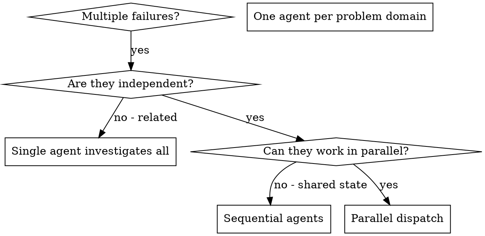

# Dispatching Parallel Agents

## Overview

You delegate tasks to specialized agents with isolated context. By precisely crafting their instructions and context, you ensure they stay focused and succeed at their task. They should never inherit your session's context or history — you construct exactly what they need. This also preserves your own context for coordination work.

When you have multiple unrelated failures (different test files, different subsystems, different bugs), investigating them sequentially wastes time. Each investigation is independent and can happen in parallel.

**Core principle:** Parallelize independent reading and isolated staging, never
shared canonical writes. One root integrator applies accepted changes
sequentially.

## Mandatory No-Overlap Preflight

For an explicit or active three-stage run, apply
`<CODEX_HOME>/policies/three-stage-runtime-v1.json`; its
`explicit_skill_or_active_run` mode permits at most one active writer. Outside
that run, this Skill still prevents overlapping canonical writes but does not
assign global Sol/Terra file permissions.

Before dispatching, inspect the current unique deliverable, authoritative TODO,
valid completion evidence, and running assignments. Stop a later assignment
when its objective or write scope overlaps active work. Reuse a prior PASS or
review receipt only when it still binds to the current revision and inputs.

Do not dispatch merely because concurrency is available. Parallel work is safe
only when each assignment has an independently verifiable output and no shared
mutable state. A Git worktree or separate directory isolates files but does not
make overlapping semantic ownership safe.

## Register Every Assignment

Create an assignment record before dispatch with these fields:

```text
assignment_id, agent_path, parent_agent, role, model, base_revision,
read_scope, write_scope, forbidden_paths, expected_outputs, acceptance,
status, return_fingerprint
```

Use exactly one role:

| Role | Write authority |
|---|---|
| `READ_ONLY_REVIEWER` | none |
| `STAGING_WRITER` | only `coordination/staging/<assignment_id>/` |
| `CANONICAL_INTEGRATOR` | root only; canonical paths |
| `AUDITOR` | none; reads a sealed revision |

Within an explicit or active three-stage run, `gpt-5.6-sol` is appropriate for
read-only analysis or plan refinement and must never receive canonical write
authority. `gpt-5.6-terra` is preferred for execution assignments. Model
identity never overrides role, scope, stage, or user authority.

Reject the assignment before dispatch when:

- its `base_revision` is not the current canonical revision;
- a read-only role has a write scope;
- a staging writer targets anything outside its owned staging directory;
- its write scope overlaps another Planned or Running assignment;
- another canonical integrator is active;
- its objective duplicates active or already valid completed work.

## Return Through Staging, Then Integrate

Agents return staged artifacts, evidence, and a `return_fingerprint`; they do
not edit canonical files. The root integrator checks assignment status, scope,
base revision, staged manifest, and acceptance evidence before applying a
change. Integrate one assignment at a time and advance the canonical revision
after every accepted change.

If a return is stale, mark it `Stale`. Re-evaluate its evidence against the new
revision and either adapt it once at integration or issue a new bounded
assignment. Never ask the same agent to repeatedly rewrite against moving files
without freezing a new base revision.

Before audit or release, require all assignments and jobs to be terminal, then
take two identical canonical manifests. Seal that revision and bind audit to the
sealed `revision_id`, `manifest_sha256`, and `scope_fingerprint`. A late write
invalidates the receipt; re-run only the affected dependency and audit chain.

## Classify Hash Drift

Do not restart work for every mtime or checksum change. Compare the registered
scope and classify drift first:

| Drift | Response |
|---|---|
| metadata-only with semantic equivalence | record; no scientific rerun |
| semantic change in scope | invalidate affected descendants and receipts |
| out-of-scope change | isolate and investigate; do not silently expand scope |
| late write after seal | invalidate the seal/receipt and reseal after quiescence |

An arbitrary retry loop is forbidden. The same drift or issue fingerprint seen
twice without new evidence is a stop condition for root review.

## When to Use



**Use when:**
- 3+ test files failing with different root causes
- Multiple subsystems broken independently
- Each problem can be understood without context from others
- No shared state between investigations

**Don't use when:**
- Failures are related (fix one might fix others)
- Need to understand full system state
- Agents would interfere with each other

## The Pattern

### 1. Identify Independent Domains

Group failures by what's broken:
- File A tests: Tool approval flow
- File B tests: Batch completion behavior
- File C tests: Abort functionality

Each domain is independent - fixing tool approval doesn't affect abort tests.

### 2. Create Focused Agent Tasks

Each agent gets:
- **Specific scope:** One test file or subsystem
- **Clear goal:** Make these tests pass
- **Constraints:** Don't change other code
- **Expected output:** Summary of what you found and fixed
- **Revision contract:** assignment ID, role, base revision, read/write scope,
  forbidden paths, staged output path, and return fingerprint

### 3. Dispatch in Parallel

Issue all three subagent dispatches in the same response — they run in parallel:

```text
Subagent (general-purpose): "Fix agent-tool-abort.test.ts failures"
Subagent (general-purpose): "Fix batch-completion-behavior.test.ts failures"
Subagent (general-purpose): "Fix tool-approval-race-conditions.test.ts failures"
# All three run concurrently.
```

Multiple dispatch calls in one response = parallel execution. One per response = sequential.

### 4. Review and Integrate

When agents return:
- Read each summary
- Verify the return fingerprint and base revision
- Reject stale or out-of-scope changes
- Integrate staged changes sequentially through root
- Run full test suite
- Seal the accepted revision before audit

## Agent Prompt Structure

Good agent prompts are:
1. **Focused** - One clear problem domain
2. **Self-contained** - All context needed to understand the problem
3. **Specific about output** - What should the agent return?

```markdown
Fix the 3 failing tests in src/agents/agent-tool-abort.test.ts:

1. "should abort tool with partial output capture" - expects 'interrupted at' in message
2. "should handle mixed completed and aborted tools" - fast tool aborted instead of completed
3. "should properly track pendingToolCount" - expects 3 results but gets 0

These are timing/race condition issues. Your task:

1. Read the test file and understand what each test verifies
2. Identify root cause - timing issues or actual bugs?
3. Fix by:
   - Replacing arbitrary timeouts with event-based waiting
   - Fixing bugs in abort implementation if found
   - Adjusting test expectations if testing changed behavior

Do NOT just increase timeouts - find the real issue.

Return: Summary of what you found and what you fixed.
```

## Common Mistakes

**❌ Too broad:** "Fix all the tests" - agent gets lost
**✅ Specific:** "Fix agent-tool-abort.test.ts" - focused scope

**❌ No context:** "Fix the race condition" - agent doesn't know where
**✅ Context:** Paste the error messages and test names

**❌ No constraints:** Agent might refactor everything
**✅ Constraints:** "Do NOT change production code" or "Fix tests only"

**❌ Vague output:** "Fix it" - you don't know what changed
**✅ Specific:** "Return summary of root cause and changes"

## When NOT to Use

**Related failures:** Fixing one might fix others - investigate together first
**Need full context:** Understanding requires seeing entire system
**Exploratory debugging:** You don't know what's broken yet
**Shared state:** Agents would interfere (editing same files, using same resources)

## Real Example from Session

**Scenario:** 6 test failures across 3 files after major refactoring

**Failures:**
- agent-tool-abort.test.ts: 3 failures (timing issues)
- batch-completion-behavior.test.ts: 2 failures (tools not executing)
- tool-approval-race-conditions.test.ts: 1 failure (execution count = 0)

**Decision:** Independent domains - abort logic separate from batch completion separate from race conditions

**Dispatch:**
```
Agent 1 → Fix agent-tool-abort.test.ts
Agent 2 → Fix batch-completion-behavior.test.ts
Agent 3 → Fix tool-approval-race-conditions.test.ts
```

**Results:**
- Agent 1: Replaced timeouts with event-based waiting
- Agent 2: Fixed event structure bug (threadId in wrong place)
- Agent 3: Added wait for async tool execution to complete

**Integration:** All fixes independent, no conflicts, full suite green

**Time saved:** 3 problems solved in parallel vs sequentially

## Key Benefits

1. **Parallelization** - Multiple investigations happen simultaneously
2. **Focus** - Each agent has narrow scope, less context to track
3. **Independence** - Agents don't interfere with each other
4. **Speed** - 3 problems solved in time of 1

## Verification

After agents return:
1. **Review each summary** - Understand what changed
2. **Check for conflicts** - Did agents edit same code?
3. **Run full suite** - Verify all fixes work together
4. **Spot check** - Agents can make systematic errors

## Real-World Impact

From debugging session (2025-10-03):
- 6 failures across 3 files
- 3 agents dispatched in parallel
- All investigations completed concurrently
- All fixes integrated successfully
- Zero conflicts between agent changes
